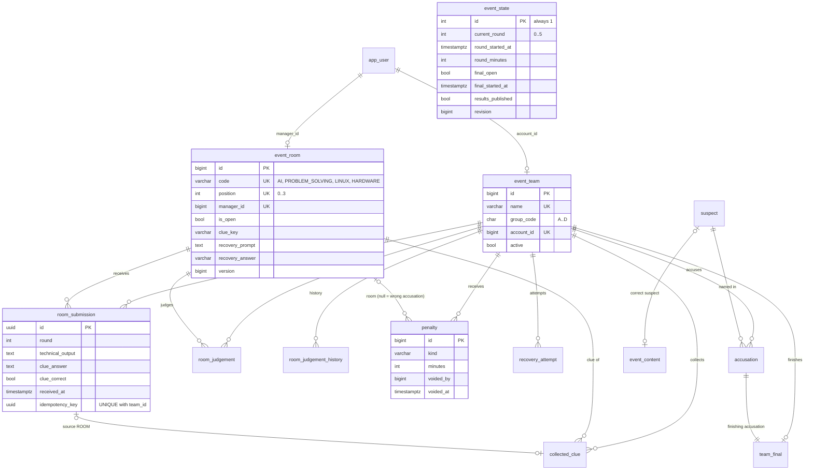

# Event architecture

Technical companion to [EVENT-RULES.md](EVENT-RULES.md). Stack: Spring Boot 4.1.1 / Java 25 with Spring JDBC
(explicit SQL), Spring Security + the existing JWT sessions, Flyway, PostgreSQL 18, Angular 22 (standalone
components, signals, OnPush). No ORM, no sockets, no extra runtime dependencies.

## Backend package layout (`dev.devfest.event`)

| Package | Responsibility | Classes |
|---|---|---|
| `web` | Thin controllers: `@Valid` request record, principal, one service call, typed DTO | `EventSharedController` (revision, home, results), `EventTeamController`, `EventManagerController`, `EventAdminController` (board, rooms, rounds, final, publication, CSV), `EventSetupController` (accounts, teams, managers, content, suspects), `EventOperationsController` (`GET /api/v1/health`) |
| `service` | Rules, authorization, transactions, audit, revision bumps — no SQL | `EventAccessPolicy`, `EventControlService`, `EventTeamBoardService`, `EventSubmissionService`, `EventFinalService`, `EventRoomBoardService`, `EventJudgingService`, `EventPenaltyService`, `EventContentService`, `EventOrganizationService`, `EventAdminBoardService`, `EventResultsService`, `EventExportService`, `EventSharedService`, `EventHealthService`; helpers `TeamWriteGate` (rate limit → locks → request hash for team POSTs), `EventClock` (server time truncated to µs), `EventText` (UTF-8 byte limits), `EventViews` (record → DTO), `EventContentGaps` (shared by alerts and the open-final check) |
| `repository` | SQL only (`JdbcTemplate`, text blocks, private row mappers); returns records/`Optional`/`List` | `EventStateRepository`, `EventRoomRepository`, `EventTeamRepository`, `RoomSubmissionRepository`, `RoomJudgementRepository`, `CollectedClueRepository`, `PenaltyRepository`, `SuspectRepository`, `EventContentRepository`, `RecoveryAttemptRepository`, `AccusationRepository`, `TeamFinalRepository`, `EventRankingRepository` (the one D12 ranking query), `EventAccountRepository`, `EventBoardRepository` (aggregated board reads), `EventHealthRepository`, plus `*Record` row types |
| `dto` | Request and response records with Jakarta validation. Member-facing types (`TeamBoard`, `TeamRoomCard`, `Receipt`, `TeamFinal`, `RecoveryResult`, `AccusationResult`, `ResultsView`, `PublicRankingRow`) have no field that could hold a clue key, recovery answer, correct suspect or another team's data | |
| `domain` | Pure Java | `RoomCode`, `GroupCode`, `JudgeStatus`, `TeamRoomStatus`, `PenaltyKind`, `FinalStage`, `Rotation`, `AnswerNormalizer`, `FinalStageResolver`, `PenaltyRules`, `EventRuleException` |
| `seed` | Development data only | `EventDevelopmentSeed` (requires `DEVFEST_EVENT_SEED_PASSWORD` **and** `DEVFEST_DEVELOPMENT=true`; refuses to start otherwise; idempotent) |

Shared pieces reused: `dev.devfest.audit.AuditLog` (also used by `ContestService.audit`), `auth.RateLimit`
(new overload with a custom message), `api.Errors` (the single `@RestControllerAdvice`, now also mapping 404 unknown
route, 405 wrong method, 400 missing header/parameter), `admin.AdminController.csvCell` (formula-safe CSV cell).

## Data model (V5)



Integrity rules in the database: CHECK constraints for every enum and every text limit (`octet_length` matching
the DTO limits, which services also enforce in bytes); `UNIQUE(team_id, idempotency_key)` on `room_submission`,
`recovery_attempt` and `accusation`; one RECOVERY penalty per team and one correct accusation per team (partial
unique indexes); triggers make submissions, recovery attempts, accusations and judgement history append-only and
allow a penalty only a single void (never a delete). All timestamps are `TIMESTAMPTZ`. Indexes exist on every
foreign key used in joins/filters and on `room_submission(room_id, received_at DESC)` and
`room_submission(team_id, room_id, received_at DESC)` (latest submission lookups).

## Team count and sessions (V6)

V6 adds `event_state.planned_team_count` (1..64, default 16) and `auth_session.revoked_reason`
(`LOGOUT`, `REPLACED`, `ORGANIZER`, `DEACTIVATED`, `PASSWORD_RESET`, `REPLAY`; NULL = expired) plus
`auth_session.last_seen_at`.

- Group capacity is pure domain code: `GroupCapacity` (cap ceil(N / 4), balance warnings) and `RoundRobinGroups`
  (new teams fill the smallest group, ties A→D, all-or-nothing). `EventOrganizationService` enforces the cap and
  the planned count under the `event_state` lock; the warnings feed both the organization response and the
  admin board alerts.
- Bulk generation hashes the generated passwords (BCrypt, in parallel) **before** its transaction, so the
  `event_state` lock covers only the inserts. Plain passwords exist only in the HTTP response.
- `AuthService` is the only code that creates or revokes sessions. A MEMBER login revokes the account's other
  open sessions as `REPLACED` in the login transaction (the `app_user` row lock serializes concurrent logins).
  Every revocation records its reason; sessions that already ended keep their first reason.
- Request authentication is one primary-key query (`auth_session ⋈ app_user`). A failure names its reason:
  the security filter stores it as a request attribute and the 401 entry point writes
  `{"status":401,"detail":…,"reason":…}`; `/auth/refresh` returns the same shape. The frontend refreshes only
  on `EXPIRED`; any other reason clears the session and shows the message on the login page.
- `last_seen_at` is written by a conditional `UPDATE … WHERE last_seen_at IS NULL OR last_seen_at < now - 60 s`
  that is issued only when the value read is older than 60 s, so steady polling adds about one write per
  session per minute. The organization query derives `signedIn` (open session seen within 2 minutes) and
  `lastSeenAt` with one LATERAL aggregate per team over `idx_session_user`.

## Clue verdicts (V7)

`room_submission` stays append-only; `clue_correct` is the result at submission time. V7 adds
`submission_clue_verdict` (one row per submission: `auto_correct` against the current key, `override`
ACCEPT/REJECT/NULL, `effective_correct`, `version`, who/when for the override; a CHECK forces
`effective_correct` = ACCEPT → true, REJECT → false, NULL → `auto_correct`) and the append-only
`submission_clue_verdict_history` (old → new override and effective result, who, when, version). Existing
submissions were backfilled from `clue_correct`.

- Domain: `ClueCheck` (normalized match; blank key never correct; `keyChanged`), `ClueVerdict.effective`, and
  `ClueOverride` (AUTOMATIC stored as NULL).
- Submitting inserts the verdict row in the submission transaction and collects the clue from the effective
  result. Opening a room and submitting both require a non-empty key; an open room's key cannot be cleared.
- A content save whose key normalizes differently runs `EventClueReviewService.recheckRoom` in the same
  transaction (locks: event_state → room): 1 SELECT of the room's answers and overrides, answers checked in
  Java with `ClueCheck`, 1 UPDATE of all verdicts through unnested arrays, then 1 DELETE and 1 INSERT … ON
  CONFLICT DO NOTHING that make ROOM-sourced `collected_clue` rows match (earliest effective-correct
  submission per team; RECOVERY rows untouched). Four statements whatever the number of submissions
  (`EventClueRecheckStatementsTest`). Audit `EVENT_CLUE_KEY_CHANGED` with the room and count, never the key.
- `PUT /rooms/{roomId}/submissions/{submissionId}/clue-override` (room manager or ADMIN): optimistic version,
  repeat of the current verdict = no-op success, 409 after the final opens; history row, audit
  `EVENT_CLUE_OVERRIDE`, revision bump, and the same two clue statements scoped to the one team.
- Team-facing receipts carry only `clueCorrect` (effective) and `updatedAfterReview` (effective ≠ result at
  submission); the manager board adds `autoCorrect`, `override`, `effectiveCorrect`, `verdictVersion` and
  `room.clueKeySet`.

## Authorization matrix

Anonymous requests get 401 on every event endpoint (only `GET /api/v1/health` is public). PARTICIPANT gets 403 on
all of `/api/v1/event/**`. "own" means the room assigned to the manager or the team derived from the member's
account — client-supplied ids never establish ownership. A foreign room/team/penalty/receipt is reported as 404.

| Endpoint (under `/api/v1/event`) | ADMIN | MANAGER | MEMBER |
|---|---|---|---|
| `GET /revision`, `GET /home` | ✔ | ✔ | ✔ |
| `GET /results` | ✔ | 403 | ✔ after publication, else 403 |
| `GET /team/board`, `/team/final`, `/team/submissions[/{id}]` | 403 | 403 | own team (foreign receipt 404) |
| `POST /team/rooms/{id}/submissions`, `/team/final/recovery`, `/team/final/accusations` | 403 | 403 | own team |
| `GET /rooms/{id}/board`, `PUT /rooms/{id}/judgements/{teamId}`, `POST /rooms/{id}/penalties`, `PUT /rooms/{id}/content`, `PUT /rooms/{id}/submissions/{submissionId}/clue-override` | any room | own room (else 404) | 403 |
| `POST /penalties/{id}/void` | any | own room's penalties (room-less → 404) | 403 |
| `/admin/**` (incl. `PUT /admin/teams/planned-count`, `POST /admin/teams/generate`, `POST /admin/teams/{id}/sign-out`) | ✔ | 403 | 403 |

Defense in depth: `SecurityConfig` restricts `/api/v1/event/admin/**` to ADMIN and `/api/v1/event/**` to the three
event roles; every public service method additionally starts with an `EventAccessPolicy` check.

## Live refresh by revision polling (D14)

`event_state.revision` is incremented inside the same transaction by every write that changes something a screen
shows. No-op writes (same round, same room state, identical judgement retry, same publication flag) and idempotent
replays do not bump it; reads never do. Each browser tab runs one `RevisionPoller` (`core/event/revision-poller.ts`):
`GET /revision` every 10 s while `document.visibilityState === 'visible'`, paused while hidden, one immediate poll on
becoming visible, no overlapping requests. Each page refetches its single aggregated board endpoint only when the
revision changes (and after its own writes). No page polls its board on a timer.

SQL statements per read (fixed, independent of team count; documented on each service method):

| Endpoint | Statements |
|---|---|
| `GET /revision` | 1 |
| `GET /team/board` | 4 (team, state, rooms with judgement/clue/latest receipt via LATERAL, finish) |
| `GET /team/final` | 3 base; +1 RECOVERY, +2 MESSAGE, +3 FINISHED (max 6) |
| `GET /rooms/{id}/board` | 4 (room, state, all teams' progress via LATERAL, room penalties) |
| `GET /admin/board` | 6 (state, room stats, active teams, ranking, content status, group sizes) |
| `GET /admin/organization` | 4 · `GET /admin/content` 4 · `GET /results` 2 · CSV export 1 |

## Idempotency and receipts

```mermaid
sequenceDiagram
  participant UI as Team browser
  participant API as Spring service (one transaction)
  participant DB as PostgreSQL
  UI->>UI: key = crypto.randomUUID(); save {key, path, body} in localStorage
  UI->>API: POST … Idempotency-Key: key
  API->>DB: rate_bucket (20/min/team)
  API->>DB: SELECT event_state FOR UPDATE → event_team FOR UPDATE
  API->>DB: SELECT … WHERE team_id = ? AND idempotency_key = ?
  alt found, same request hash
    API-->>UI: original receipt (even if the room/final closed since)
  else found, different hash
    API-->>UI: 409 key already used
  else new
    API->>DB: rules (round, schedule, open / stage) → INSERT (received_at = server time, µs) → side effects → revision+1 → audit
    API-->>UI: receipt
  end
  UI->>UI: clear stored attempt on any response; on network failure show "Retry" (same key and body, also after reload)
```

The request hash is SHA-256 of a discriminator (room id, `recovery`, `accusation`) plus the JSON body.

## Lock order and timeouts

Every event write takes locks in one order (documented on `EventStateRepository`): the per-team `rate_bucket` row
(team POSTs only) → `event_state` `FOR UPDATE` → `event_team` row → `event_room` row. Because every writer locks
`event_state` first, event writes are serialized; each transaction is a handful of indexed statements with no network
or file I/O. Fail-fast settings: Hikari `connection-timeout=5000` ms and `spring.jdbc.template.query-timeout=5s`.

## Frontend structure (`frontend/src/app`)

- `core/event/`: `event-models.ts` (types of every DTO), `event-api.ts` (one typed method per endpoint),
  `revision-poller.ts`, `pending-request.ts` (localStorage attempt store), `countdown.ts` and `format.ts` (pure helpers).
- `core/guards.ts` + `core/role-home.ts`: `eventAdminGuard`, `managerGuard` (MANAGER or ADMIN), `memberGuard`,
  `eventResultsGuard`, `codingGuard`, `roleHomeGuard` (login, `''` and `'**'` go to the role's home).
- `core/shell/`: `event-shell.ts` + `event-nav.ts` (event roles) and `coding-shell.ts` (PARTICIPANT, unchanged contest UI).
- `features/event/admin/` (control, teams & accounts, content), `features/event/manager/` (room board),
  `features/event/team/` (home, final), `features/event/results/`. All routes are lazy; Monaco loads only with the
  coding workspace route.
- `shared/ui/`: existing controls plus `ui-status-chip`, `ui-metric-tile`, `ui-countdown`, `ui-confirm-dialog`, `ui-page-state`.
