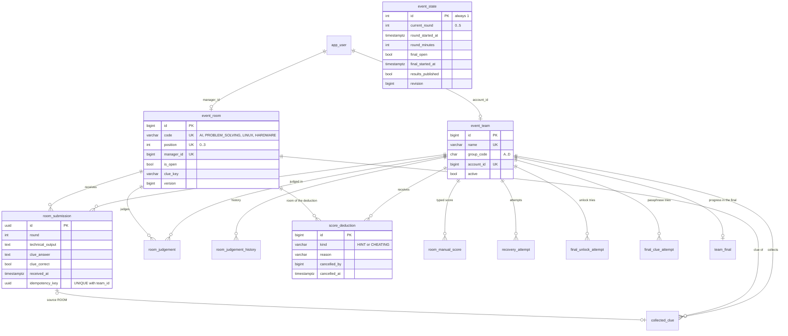
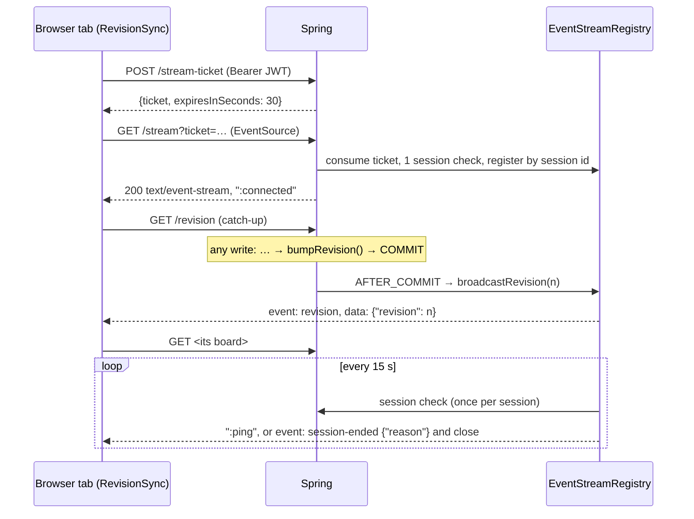

# Event architecture

Technical companion to [EVENT-RULES.md](EVENT-RULES.md). Stack: Spring Boot 4.1.1 / Java 25 with Spring JDBC
(explicit SQL), Spring Security + the existing JWT sessions, Flyway, PostgreSQL 18, Angular 22 (standalone
components, signals, OnPush). No ORM, no sockets. Frontend runtime dependencies beyond Angular: `monaco-editor`
(coding workspace) and, for the in-browser terminal only, `v86` and `@xterm/xterm` (lazy chunks).

## Backend package layout (`dev.devfest.event`)

| Package | Responsibility | Classes |
|---|---|---|
| `web` | Thin controllers: `@Valid` request record, principal, one service call, typed DTO | `EventSharedController` (revision, home, results), `EventTeamController`, `EventManagerController`, `EventAdminController` (board, rooms, rounds, final, publication, CSV), `EventSetupController` (accounts, teams, managers, room content), `EventOperationsController` (`GET /api/v1/health`), `EventStreamController` (stream ticket, SSE revision stream) |
| `service` | Rules, authorization, transactions, audit, revision bumps — no SQL | `EventAccessPolicy`, `EventControlService`, `EventTeamBoardService`, `EventSubmissionService`, `EventFinalService`, `EventRoomBoardService`, `EventJudgingService`, `EventDeductionService` (hints, cheating), `EventManualScoreService`, `EventFinalContentService`, `EventFinalTimerService`, `EventFinalBoardService`, `ScoreBreakdownService` (the one score and ranking read), `TerminalScoreService`, `EventContentService`, `EventOrganizationService`, `EventAdminBoardService`, `EventResultsService`, `EventExportService`, `EventSharedService`, `EventHealthService`, `StreamTicketService`, `EventStreamRegistry` + `RevisionBroadcaster` (revision push); helpers `TeamWriteGate` (rate limit → locks → request hash for team POSTs), `EventClock` (server time truncated to µs), `EventText` (UTF-8 byte limits), `EventViews` (record → DTO), `EventContentGaps` (shared by alerts and the open-final check) |
| `repository` | SQL only (`JdbcTemplate`, text blocks, private row mappers); returns records/`Optional`/`List` | `EventStateRepository`, `EventRoomRepository`, `EventTeamRepository`, `RoomSubmissionRepository`, `RoomJudgementRepository`, `CollectedClueRepository`, `DeductionRepository`, `ManualScoreRepository`, `FinalContentRepository`, `FinalAdjustmentRepository`, `RecoveryAttemptRepository`, `TeamFinalRepository` (the final row, unlock and passphrase attempts), `FinalTerminalBundleRepository` (the final's own terminal package), `EventAccountRepository`, `EventBoardRepository` (aggregated board reads), `EventHealthRepository`, plus `*Record` row types |
| `dto` | Request and response records with Jakarta validation. Member-facing types (`TeamBoard`, `TeamRoomCard`, `Receipt`, `TeamFinal`, `FinalActionResult`, `RecoveryResult`, `ResultsView`, `PublicRankingRow`) have no field that could hold a passphrase or its hash, an unsolved file's report, a recovery answer, the correct suspect, a deduction or another team's data; the only clue key a member can receive is `RoomEvidence.clueValue`, set only for a finished room whose clue the team collected (`EvidenceVisibility`, rules §17) | |
| `domain` | Pure Java | `RoomCode`, `GroupCode`, `JudgeStatus`, `TeamRoomStatus`, `DeductionKind`, `FinalStage`, `FinalScreen`, `Rotation`, `AnswerNormalizer`, `FinalStageResolver`, `RoomScoring`, `FinalScoring`, `EventRanking`, `AttemptThrottle`, `ShipmentContent` + `ShipmentContentRules` (the content file, format 2, and its validation), `Passphrase` (trim, lower-case, SHA-256 compare), `EvidenceVisibility` (room finished for a team; when its clue key may be shown), `EventRuleException` |
| `seed` | Development data only | `EventDevelopmentSeed` (requires `DEVFEST_EVENT_SEED_PASSWORD` **and** `DEVFEST_DEVELOPMENT=true`; refuses to start otherwise; idempotent) |

Shared pieces reused: `dev.devfest.audit.AuditLog` (also used by `ContestService.audit`), `auth.RateLimit`
(new overload with a custom message), `api.Errors` (the single `@RestControllerAdvice`, now also mapping 404 unknown
route, 405 wrong method, 400 missing header/parameter), `admin.AdminController.csvCell` (formula-safe CSV cell).

## Data model (V5)



Integrity rules in the database: CHECK constraints for every enum and every text limit (`octet_length` matching
the DTO limits, which services also enforce in bytes); `UNIQUE(team_id, idempotency_key)` on `room_submission`,
`recovery_attempt` and the unlock and passphrase attempts; one correct attempt per team and clue and one active cheating
violation per team and room (partial unique indexes); triggers make submissions, the final's attempts and
judgement history append-only and allow a deduction only a single cancellation (never a delete). All timestamps are `TIMESTAMPTZ`. Indexes exist on every
foreign key used in joins/filters and on `room_submission(room_id, received_at DESC)` and
`room_submission(team_id, room_id, received_at DESC)` (latest submission lookups).

## Team count and sessions (V6)

V6 adds `event_state.planned_team_count` (1..64, default 16) and `auth_session.revoked_reason`
(`LOGOUT`, `REPLACED`, `ORGANIZER`, `DEACTIVATED`, `PASSWORD_RESET`, `REPLAY`; NULL = expired) plus
`auth_session.last_seen_at`.

- Group capacity is pure domain code: `GroupCapacity` (cap ceil(N / 4), balance warnings) and `RoundRobinGroups`
  (new teams fill the smallest group, ties A→D, all-or-nothing). `EventOrganizationService` enforces the cap and
  the planned count under the `event_state` lock; the warnings feed both the organization response and the
  admin board alerts.
- Bulk generation hashes the generated passwords (BCrypt, in parallel) **before** its transaction, so the
  `event_state` lock covers only the inserts. Plain passwords exist only in the HTTP response.
- `AuthService` is the only code that creates or revokes sessions. A MEMBER login revokes the account's other
  open sessions as `REPLACED` in the login transaction (the `app_user` row lock serializes concurrent logins).
  Every revocation records its reason; sessions that already ended keep their first reason.
- Request authentication is one primary-key query (`auth_session ⋈ app_user`). A failure names its reason:
  the security filter stores it as a request attribute and the 401 entry point writes
  `{"status":401,"detail":…,"reason":…}`; `/auth/refresh` returns the same shape. The frontend refreshes only
  on `EXPIRED`; any other reason clears the session and shows the message on the login page.
- `last_seen_at` is written by a conditional `UPDATE … WHERE last_seen_at IS NULL OR last_seen_at < now - 60 s`
  that is issued only when the value read is older than 60 s, so steady polling adds about one write per
  session per minute. The organization query derives `signedIn` (open session seen within 2 minutes) and
  `lastSeenAt` with one LATERAL aggregate per team over `idx_session_user`.

## Clue verdicts (V7)

`room_submission` stays append-only; `clue_correct` is the result at submission time. V7 adds
`submission_clue_verdict` (one row per submission: `auto_correct` against the current key, `override`
ACCEPT/REJECT/NULL, `effective_correct`, `version`, who/when for the override; a CHECK forces
`effective_correct` = ACCEPT → true, REJECT → false, NULL → `auto_correct`) and the append-only
`submission_clue_verdict_history` (old → new override and effective result, who, when, version). Existing
submissions were backfilled from `clue_correct`.

- Domain: `ClueCheck` (normalized match; blank key never correct; `keyChanged`), `ClueVerdict.effective`, and
  `ClueOverride` (AUTOMATIC stored as NULL).
- Submitting inserts the verdict row in the submission transaction and collects the clue from the effective
  result. Opening a room and submitting both require a non-empty key; an open room's key cannot be cleared.
- A content save whose key normalizes differently runs `EventClueReviewService.recheckRoom` in the same
  transaction (locks: event_state → room): 1 SELECT of the room's answers and overrides, answers checked in
  Java with `ClueCheck`, 1 UPDATE of all verdicts through unnested arrays, then 1 DELETE and 1 INSERT … ON
  CONFLICT DO NOTHING that make ROOM-sourced `collected_clue` rows match (earliest effective-correct
  submission per team; RECOVERY rows untouched). Four statements whatever the number of submissions
  (`EventClueRecheckStatementsTest`). Audit `EVENT_CLUE_KEY_CHANGED` with the room and count, never the key.
- `PUT /rooms/{roomId}/submissions/{submissionId}/clue-override` (room manager or ADMIN): optimistic version,
  repeat of the current verdict = no-op success, 409 after the final opens; history row, audit
  `EVENT_CLUE_OVERRIDE`, revision bump, and the same two clue statements scoped to the one team.
- Team-facing receipts carry only `clueCorrect` (effective) and `updatedAfterReview` (effective ≠ result at
  submission); the manager board adds `autoCorrect`, `override`, `effectiveCorrect`, `verdictVersion` and
  `room.clueKeySet`.

## Round timer (V8)

`event_state` gains `round_phase` (ASSIGNED / RUNNING / PAUSED, NULL in rounds 0 and 5), `round_duration_seconds`,
`round_elapsed_before_seconds`, `round_resumed_at` and `round_ended`; `round_started_at` is now the first start
of the timer (NULL while ASSIGNED). CHECK constraints tie the phase to rounds 1–4, require a resume time while
RUNNING, and keep ASSIGNED unstarted. `room_arrival(round, room_id)` holds "All teams are here";
`round_time_adjustment(round, idempotency_key)` makes a repeated adjust request a no-op.

- `RoundTimer` (domain, immutable, whole seconds) owns all timer math: `remainingSeconds(now)`,
  `effectivePhase(now)` (TIME_UP derived), `start/pause/resume/addSeconds/removeSeconds/endNow`. A transition
  into the current state returns the same timer, which the service treats as a no-op (no audit, no bump);
  an impossible transition throws `IllegalTransition` → 409. No scheduler: TIME_UP is computed on read.
- `EventControlService.setRound` begins a running round ASSIGNED with `round_minutes × 60` and clears
  arrivals left from an earlier visit to the same round number. `EventRoundTimerService` (admin) and
  `EventArrivalService` (room manager or admin) lock `event_state` first, store the transition, audit it and
  bump the revision in one transaction. The timer ticking never bumps the revision.
- `EventSubmissionService` checks the phase at `now` under the `event_state` lock, after the idempotent-retry
  lookup and right after "rooms running": ASSIGNED / PAUSED / TIME_UP → 409.
- Boards send `RoundClock {currentRound, phase, remainingSeconds, durationSeconds, serverNow}` (the admin's
  `EventStateView` carries the same fields). The browser counts down from `remainingSeconds` by the local time
  elapsed since the response arrived (independent of clock offset) and restarts from the server value at every
  refetch and on tab visibility change.

## Scoring and the crypto final (V20, rules §8 to §12)

V20 retires the minute-based penalties, adjusted time, the per-room recovery challenges, the encrypted-message final
and its accusations (tables `penalty`, `suspect`, `accusation`, the old `team_final`, `event_content`), and adds
`score_deduction`, `room_manual_score`, `final_content`, the final's timer columns on `event_state`,
`final_time_adjustment`, the new `team_final`, `final_unlock_attempt`, `final_layer_attempt`, `final_verdict` and the
new `recovery_attempt`.

V22 replaces the crypto case with "The Last Shipment" (rules §10): it drops `final_layer_attempt` and `final_verdict`,
turns `team_final.suspect_id` into the content file's suspect id (text), removes the format-1 content row, and adds
`final_clue_attempt` (append-only passphrase attempts, one correct row per team and clue) and `final_terminal_bundle`
(the final's own terminal package, one row, never shared with `room_terminal_bundle`).

- **One score read.** `ScoreBreakdownService` computes every team's four room scores and its final in a fixed number of
  statements: the AI mission's total (× 0.15), the Linux terminal's and the contest's /15 scores, or the typed score,
  then `RoomScoring` (MAX(0, base − 2 × hints − 7.5 if cheating)) and `FinalScoring`; `EventRanking` (pure) orders
  them. Nothing is stored; the admin board, results, CSV and the team's own final use it.
- **One timer.** The final's 40 minutes are the `RoundTimer` arithmetic on `event_state`: running from the moment the
  admin opens the final, one pause, resume and added time for every team, a team's active seconds at its suspect
  submission feed the time points.
- **Exactly-once finalisation.** Every final write takes the `event_state` lock first (`TeamWriteGate`); a write that
  finds no time left finalises the team and is answered 409 with the finalisation kept (`FinalTimeUp`,
  `noRollbackFor`), the admin's close finalises everyone still open, and the guarded `UPDATE … WHERE finalised_at IS
  NULL` makes a race harmless. There is no scheduler.
- **Secrets.** The content file's plaintexts, private exponents and verdicts are derived in `CryptoContent` and never
  reach a member DTO; one-time actions (verdict, suspect) answer identically whether or not they were right.

V21 drops the judgement's own informational hint counter (`room_judgement.hints`, `room_judgement_history.hints`): nothing
read it, and hints are now only the −2 deductions of V20. A judgement is a status and a note.

## Admin overrides (V9)

V9 adds `team_room_exception(round, team_id)`, `event_snapshot` (JSONB copy of deleted rows), `audit_event.reason`,
`event_team.disqualified*` and the collected-clue source `MANUAL` (its time-adjustment penalty kind was retired by V20). The append-only trigger functions now allow DELETE only
when the transaction-local setting `devfest.allow_reset` is `on`; UPDATE stays refused.

- `RoomAssignment` (domain) is the single resolver of a team's room in a round (exception, else rotation). It is
  used by the submission check, the team board, the room boards ("teams expected now", "in room now") and the
  admin board's "teams now".
- `RotationPreview` (domain) computes the swap/move preview (rooms visited, remaining rounds, MISS / REPEAT).
- `EventOverrideService` (swap, move, room exception, manual clue, disqualification) and
  `EventResetService` (resets, snapshots) are ADMIN only, lock `event_state` → teams by ascending id → room, audit
  with the reason and bump the revision. Resets save the snapshot first (`EventSnapshotRepository`: one
  `INSERT … SELECT jsonb_build_object(...)`), then `EventResetRepository.allowResetDeletes()` and one bulk DELETE
  per table in foreign-key order.
- The ranking (`EventRanking`, pure) lists disqualified teams last without a rank. The disqualified check sits right
  after the idempotent-retry lookup of room submissions and of every step of the final.

## Evidence (rules §17)

- `EventBoardRepository.teamRooms` (the one team-rooms statement) also returns the latest submission's technical
  output and clue answer, and `CASE WHEN collected THEN r.clue_key END`, so the key of an uncollected room never
  leaves the database. `TeamRoomExceptionRepository.findForTeam` gives every room exception of the team.
- `EvidenceVisibility` (domain, pure) decides per room: finished = a round in which the team was assigned to the
  room (exception, else rotation; `RoomAssignment`) is over (earlier than the current round, or the current round
  at TIME_UP), or round 5 / final ever opened; the key is shown only when finished and collected.
- `EventViews.evidence` maps rooms → `RoomEvidence {roomCode, roomName, finished, technicalOutput, clueAnswer,
  clueCorrect, clueCollected, clueValue}`; unfinished rooms carry only code, name, `finished` and
  `clueCollected`. `TeamBoard.evidence` and `TeamFinal.evidence` both use it. The key is read live, so it follows
  key changes.
- Browser: `EventMaskedClue` (dots, eye toggle with "Show clue"/"Hide clue", auto-hide after 15 s, on tab hidden
  and on navigation, Copy without revealing), `EventTeamEvidenceCard` (team home, finished rooms only),
  `EventFinalEvidence` ("Your evidence" on the final page except LOCKED and CLOSED).

## In-browser terminal (V10, rules §18)

Teams get a Linux shell for rooms with the terminal enabled. **The emulation is client-only**: an x86 emulator
compiled to WebAssembly ([v86](https://github.com/copy/v86)) boots a small Linux (Buildroot 2018.08, BusyBox 1.28.4,
kernel 4.16) inside the team's browser tab, and xterm.js draws its serial console. No shell, container or VM runs on
the server; the backend stores text files and decides who may receive them. The VM has **no network card**
(`net_device: {type: "none"}`; only `lo` exists, `ping` answers "Network is unreachable").

**Static assets** (`frontend/public/terminal/`, versions and SHA-256 in `ATTRIBUTION.md`): `libv86.js` (classic
script, defines `window.V86`), `v86.wasm.gz`, `seabios.bin.gz`, `vgabios.bin.gz`, `linux4.iso.gz`. The binaries are
stored gzipped (`tools/gzip-terminal-assets.mjs`) and inflated by the page with `DecompressionStream`, so they travel
compressed from any static server — the Angular dev server compresses nothing and labels `.gz` files
`Content-Encoding: gzip`, so the loader checks the gzip magic bytes before inflating. URLs carry `?v=<ASSET_VERSION>`;
nginx serves `/terminal/` with `Cache-Control: public, max-age=31536000, immutable` and gzips `libv86.js`
(`infrastructure/nginx.conf.example`). Its CSP adds `'wasm-unsafe-eval'` (WebAssembly compilation, including v86's
x86→wasm JIT; it does not allow `eval`). Compressed download ≈ 7.9 MB (7.6 MB raw image + wasm + BIOS, plus 360 kB of
script, about 100 kB when gzipped by nginx).

**Data (V10)**: `event_room.terminal_enabled BOOLEAN NOT NULL DEFAULT FALSE` (the migration turns it on for `LINUX`;
no code path tests the room code) and `room_terminal_file(id, room_id → event_room, path, content TEXT CHECK
octet_length ≤ 2 MiB, size_bytes = octet_length(content), updated_by → app_user, updated_at, UNIQUE(room_id, path))`
with a CHECK on the path characters. `audit_event.target` widens to 200 characters so a terminal audit can name the
120-character path. Terminal files are content: resets keep them.

**Server package (V13, rules §18.6)**: `room_terminal_bundle(room_id PK → event_room, archive BYTEA (STORAGE EXTERNAL),
archive_bytes, sha256, file_count, unpacked_bytes, owners, etc_passwd, etc_group, uploaded_by, uploaded_at)` is kept
apart from the room rows so that no board or list query reads the blob (`RoomTerminalBundleRepository.find` leaves the
column out; only `archive(roomId)` reads it, in one statement together with its digest). Layers: pure domain classes
`TerminalPackageReader` (ZIP → members under hard limits, real bytes counted), `TerminalPackagePaths`, `TerminalManifest`,
`TerminalAccounts` (ids from 2000 by name), `TerminalTarWriter` (ustar + gzip, byte-exact, numeric owners, prefix field
for long paths) and `TerminalBundles` (the whole build, deterministic: the same ZIP gives the same SHA-256);
`EventTerminalBundleService` validates and builds **before** its transaction starts (no connection or lock is held
while a large ZIP is processed), then stores under the usual event lock and edit lock and audits hash and counts;
`EventTerminalBundleController` serves it. Delivery shares the gate of the text files
(`EventTerminalService.requireDeliverable`), then answers 404/304/200 from one light query; `TerminalBundleCache` holds
the last served archive of each room softly so simultaneous downloads share one load (an entry is used only when its
digest equals the database's). `event_room.activity` also accepts `LINUX_TERMINAL` (V13 sets it for `LINUX` on a fresh
setup). The page installs the package in `linux-session.ts`: 9p `create_file`, one invisible shell
command, a failure mark that ends in a clear error.

**Team form (V14, rules §18.7)**: `terminal_form(team_id, room_id → PK, six value columns ≤ 500 bytes, saved_at,
submitted_at, submission_id UNIQUE → room_submission, cause SUBMIT | TIME_UP)` and `terminal_form_request(team_id,
idempotency_key → PK, room_id, kind SAVE | SUBMIT, request_hash)` (every Save and Final submit by its key, so a retry is
replayed and a stale retry cannot overwrite a newer save). `TerminalFormService` takes the usual `TeamWriteGate` locks;
the final answer goes through `EventSubmissionService.recordFormAnswer` (the ordinary insert, clue check and ROOM
clue; a blank clue is stored as a note because a submission keeps at least one byte) and the guarded
`TerminalFormRepository.submit` (`WHERE submitted_at IS NULL`) makes a second trigger a no-op. The round's end hook
`TerminalFormService.submitRoundEnd` runs next to `AiRoomEvaluationService.evaluateRoundEnd` in the same two places
(`EventRoundTimerService.apply`, `EventControlService.setRound`), under the same event_state lock, so a Final submit
and Time's up run one after the other. A form submission is hidden from the team's receipts (`NOT_ACTIVITY_RESULT`) and
counts as a recorded result for `EvidenceVisibility`; resets and snapshots list both tables.

**Organizer dashboard (V15, rules §18.8)**: `terminal_answer_key(room_id PK, four multi-value text columns)`
and `terminal_form_override(team_id, room_id, item PK, awarded)` (items PATH, USERNAME, FILE_SIZE, PATTERN, CLUE (shown as FILE_NAME and RETRIEVED KEY); absence = automatic; clearing deletes the row, the
audit keeps the history). Pure domain classes: `TerminalAnswerKeys` (the comparison rules) and `TerminalFormScoring`
(3 points per item, 15 at most, overrides applied; **nothing is stored**: every read recomputes from the form rows, the
current keys, the room's clue key and the overrides). `TerminalDashboardService.view` reads in 5 statements whatever
the number of teams (room, event state, keys, all active teams LEFT JOIN their forms, overrides); access is
`EventAccessPolicy.requireOrganizerOf`, which answers 404 to every other account so the page's existence stays hidden.
The admin board adds one statement (`TerminalAnswerKeyRepository.forFormRooms`) for its "no answer key" warning.
Overrides never touch `collected_clue` or `room_submission`; the event ranking queries do not read these tables.

**Server side** (`EventTerminalService`, `RoomTerminalFileRepository`, `EventTerminalController`, domain
`TerminalFiles`):

- `TerminalFiles.pathProblem` (relative, `[A-Za-z0-9._/-]`, ≤ 120, no `..`/`.`/empty segment) and the limits 20 files,
  2 MiB per file, 5 MiB per room. Writes lock `event_state` → `event_room`, then require: content editable (final never
  opened, 409), terminal enabled (409), path unused (409), ≤ 20 files and ≤ 5 MiB in total (409; the total is checked
  under the `event_state` lock, so two concurrent saves cannot both pass). NUL characters are refused (400). Audit
  `EVENT_TERMINAL_FILE_{CREATED,UPDATED,DELETED}` with `room:<id> path:<path> bytes:<n>`, never the content; revision
  bump. The JSON body limit is not raised: Spring has none for JSON, and nginx raises `client_max_body_size` to 5 MB only
  for `/api/v1/event/rooms/{id}/terminal-files`.
- `TerminalFiles.deliverableTo` is the delivery rule (D5): terminal enabled, team not disqualified, phase ASSIGNED /
  RUNNING / PAUSED at `now` (TIME_UP derived as everywhere), and `RoomAssignment.isIn(room, group, round, exception)` —
  the same resolver the submission check uses. Anything else is 404 "Terminal files not found.".
- `PUT /admin/rooms/{id}/terminal` (ADMIN, any time; a repeat is a no-op) audits `EVENT_TERMINAL_ENABLED/DISABLED` and
  bumps the revision. The admin board adds the alert `TERMINAL_WITHOUT_FILES` (linking to the room board) from the
  existing room-stats statement (`terminal_enabled` and a per-room file count were added to it; still one statement).
- The team board's `scheduledRoom.terminalEnabled`, the room board's `room.terminalEnabled` and the content page's
  `rooms[].terminalEnabled` come from columns added to statements that already run (no extra statement).

| Endpoint (under `/api/v1/event`) | Statements |
|---|---|
| `GET /team/rooms/{id}/terminal-files` | 5 (team, state, room, the team's exception this round, files with content) |
| `GET /rooms/{id}/terminal-files` | 3 (room/access, state, file summaries without content) |

**Browser** (`features/event/terminal/`, all lazy):

- `terminal-assets.ts`: downloads the four `.gz` files with a byte-count progress signal, inflates them, keeps the
  `ArrayBuffer`s for restarts and releases them when the team page goes away; loads `libv86.js` with a script tag.
  The team page imports it dynamically while the round is ASSIGNED (background preload), never otherwise.
- `linux-session.ts`: `new V86({wasm_fn (instantiates the preloaded wasm), bios/vga_bios/cdrom: {buffer}, memory 64
  MiB, filesystem: {} (empty 9p), net_device: {type: "none"}, disable_keyboard/mouse/speaker})`. It waits for the shell
  prompt on serial 0, creates the room's files on the 9p share (`fs9p.CreateDirectory` for sub-directories, then
  `create_file`), types one hidden setup line (`stty cols 80 rows 24; mkdir -p ~/logs; cp -r /mnt/. ~/; cd ~; echo
  <mark>`) and starts forwarding serial output to the screen right after the mark (the boot log is never shown).
- `linux-terminal.ts` (`EventLinuxTerminal`, the only importer of `@xterm/xterm`, `ViewEncapsulation.None` so xterm's
  CSS applies): progress bar in MB, boot, banner, Restart (confirmation), Copy selection, Use selection as technical
  output, `beforeunload` warning while booting or running, "Time is up" (input off, VM stopped), `destroy()` on leave.
- `team/room-workspace.ts` (team home) shows the split view (≥ 900 px: terminal ≈ 60 % left, the unchanged
  `EventRoomSubmissionPanel` right) or the phone note; the terminal is rendered inside `@defer (on immediate)` only after
  **Start terminal**, so its chunk (`linux-terminal`, xterm included) is never fetched otherwise. A started terminal
  keeps its room and round; when either changes or TIME_UP arrives it shows "Time is up".
- `manager/terminal-files-card.ts`: the room board's **Terminal files** section (list, usage bar against 5 MB, add by
  paste or `File.text()` of a `.txt`/`.log`, edit, delete, **Test terminal** with the same component via
  `GET /rooms/{id}/terminal-files/content`). Admin Content page: a **Terminal enabled** checkbox per room.

## Authorization matrix

Anonymous requests get 401 on every event endpoint (only `GET /api/v1/health` is public; `GET /event/stream`
passes the security filter but answers 401 without a valid ticket). PARTICIPANT gets 403 on
all of `/api/v1/event/**`. "own" means the room assigned to the manager or the team derived from the member's
account — client-supplied ids never establish ownership. A foreign room, team, deduction or receipt is reported as 404.

| Endpoint (under `/api/v1/event`) | ADMIN | MANAGER | MEMBER |
|---|---|---|---|
| `GET /revision`, `GET /home`, `POST /stream-ticket` | ✔ | ✔ | ✔ |
| `GET /stream?ticket=…` (no bearer token; the single-use ticket names the account and session) | ✔ | ✔ | ✔ |
| `GET /results` | ✔ | 403 | ✔ after publication, else 403 |
| `GET /team/board`, `/team/final`, `/team/submissions[/{id}]` | 403 | 403 | own team (foreign receipt 404) |
| `POST /team/rooms/{id}/submissions`, `/team/final/{recovery,unlock,start,layers/{n},verdicts/{n},suspect}` | 403 | 403 | own team |
| `GET /team/rooms/{id}/terminal-files` | 403 | 403 | own team, only its assigned terminal room while ASSIGNED/RUNNING/PAUSED (else 404) |
| `GET/POST /rooms/{id}/terminal-files`, `GET /rooms/{id}/terminal-files/content`, `GET/PUT/DELETE /rooms/{id}/terminal-files/{fileId}` | any room | own room (else 404) | 403 |
| `GET /rooms/{id}/board`, `PUT /rooms/{id}/judgements/{teamId}`, `POST /rooms/{id}/{hints,cheating}` (a team in the room now), `GET /rooms/{id}/deductions`, `PUT /rooms/{id}/manual-scores/{teamId}`, `PUT /rooms/{id}/content`, `PUT /rooms/{id}/submissions/{submissionId}/clue-override` | any room | own room (else 404) | 403 |
| `POST /deductions/{id}/cancel` | any | own room's deductions for a team in the room now (else 404) | 403 |
| `PUT /rooms/{id}/arrival` | any room | own room (else 404) | 403 |
| `/admin/**` (incl. `PUT /admin/rooms/{id}/terminal`, `/admin/overrides/**`, `/admin/reset/**`, `/admin/snapshots/**`, `PUT /admin/teams/{id}/group`, `POST /admin/teams/{id}/{disqualify,reinstate}`, `POST /admin/round/timer/{start,pause,resume,adjust,end}`, `PUT /admin/teams/planned-count`, `POST /admin/teams/generate`, `POST /admin/teams/{id}/sign-out`) | ✔ | 403 | 403 |

Defense in depth: `SecurityConfig` restricts `/api/v1/event/admin/**` to ADMIN and `/api/v1/event/**` to the three
event roles; every public service method additionally starts with an `EventAccessPolicy` check.

## Revision push (SSE) with polling fallback (D14)

`event_state.revision` is incremented inside the same transaction by every write that changes something a screen
shows. No-op writes (same round, same room state, identical judgement retry, same publication flag) and idempotent
replays do not bump it; reads never do. The server pushes only the new **number** to open tabs; each page then
refetches its single aggregated board endpoint, so authorization and data shaping stay in the board endpoints. A
page also refetches right after its own successful write, so the person who clicked never waits for the push.



- **Tickets** (`StreamTicketService`): `POST /api/v1/event/stream-ticket` (any event role, `EventAccessPolicy`
  first, `RateLimit` 30 per account per minute) returns 256 random bits from `SecureRandom`, bound to the caller's
  account and session id, kept only in this server's memory and valid for 30 s. `GET /api/v1/event/stream?ticket=…`
  removes the ticket on first use: missing, unknown, reused or expired → 401. The stream URL is public in
  `SecurityConfig` because EventSource cannot send an `Authorization` header; no JWT ever appears in a URL.
- **After-commit broadcast, one place**: `EventStateRepository.bumpRevision()` publishes `RevisionBumped`;
  `RevisionBroadcaster` listens with `@TransactionalEventListener` (AFTER_COMMIT), so a rolled-back write is never
  announced and no service had to change. Sends run on one `event-stream-sender` thread, never on the committing
  request thread; a burst of commits collapses into one send of the highest number.
- **Streams** (`EventStreamRegistry`, `EventStreamController`): `SseEmitter` (async; no request thread, transaction
  or JDBC connection is held while a stream is open), timeout 30 min (the browser then reconnects with a new
  ticket), headers `Content-Type: text/event-stream`, `Cache-Control: no-cache`, `X-Accel-Buffering: no`. The
  registry is keyed by session id. Events: `revision` `{"revision": n}`, `session-ended` `{"reason": "REPLACED"}`;
  comments `:connected` (first bytes, so the browser reports the stream open) and `:ping`.
- **Heartbeat and session closing**: every 15 s (`app.event-stream.heartbeat`) the `event-stream-heartbeat`
  thread runs `AuthService.checkSession` (the same one-row check as every request) once per session and pings its
  streams. A session that can no longer be used gets `session-ended` with the reason and its streams complete.
  Revocations through `AuthService` (REPLACED at a team's second sign-in, ORGANIZER, DEACTIVATED, PASSWORD_RESET,
  LOGOUT, REPLAY) publish `SessionsRevoked`, which closes that session's streams right after the revoking
  transaction commits. Deactivating a team revokes its account's sessions (DEACTIVATED), so it is covered too.
- **Client** (`RevisionSync`, `core/event/revision-sync.ts`, started by `App` for event roles, stopped on sign-out):
  gets a ticket, opens an EventSource and raises `revision()` on every higher pushed number; on open and on every
  reconnect it calls `GET /revision` once to catch up. While the stream is not open it polls `GET /revision` every
  3 s and reconnects with a fresh ticket after 1 s, 2 s, 5 s, then every 10 s (the browser's own retry would reuse
  the spent ticket). While the stream is healthy a safety poll runs every 30 s. A hidden tab keeps its stream but
  skips polls; becoming visible polls once. On `session-ended` it closes everything and calls `GET /revision`, whose
  401 with the reason drives the existing sign-out handling (`api.ts`: message on the login page). Pages keep using
  `reloadOnRevisionChange` and `revision()` unchanged.
- **Reverse proxy**: a proxy in front of the app must not buffer `/api/v1/event/stream` and must allow long-lived
  responses (nginx: `proxy_buffering off; proxy_read_timeout 35m;`, see `infrastructure/nginx.conf.example`). The
  Angular dev proxy (`proxy.conf.json`, and the rehearsal's `.local/event-proxy.json`) passes the stream unbuffered
  as configured.

SQL statements per read (fixed, independent of team count; documented on each service method):

| Endpoint | Statements |
|---|---|
| `GET /revision` | 1 |
| `GET /team/board` | 5 (team, state, rooms with judgement/clue/latest submission and collected key via LATERAL, the final flag and hint count, the team's room exceptions) |
| `GET /team/final` | 11 (team, state, clue facts, final row, content, solved layers, verdicts, rooms, the evidence's rooms and exceptions, plus the answer screen's wrong-answer streak) |
| `GET /rooms/{id}/board` | 6 (room, state, all teams' progress via LATERAL, the room's deductions, every team's hint count, typed scores for a room without an automatic score) |
| `GET /admin/board` | 16 (state, room stats, active teams, the score breakdown reads, the final content, group sizes, flags, overrides, …) |
| `GET /admin/organization` | 4 · `GET /admin/content` 2 · `GET /admin/scores` 7 · `GET /results` 7 · CSV export 8 · `GET /rooms/{id}/deductions` 2 |

## Idempotency and receipts

```mermaid
sequenceDiagram
  participant UI as Team browser
  participant API as Spring service (one transaction)
  participant DB as PostgreSQL
  UI->>UI: key = crypto.randomUUID(); save {key, path, body} in localStorage
  UI->>API: POST … Idempotency-Key: key
  API->>DB: rate_bucket (20/min/team)
  API->>DB: SELECT event_state FOR UPDATE → event_team FOR UPDATE
  API->>DB: SELECT … WHERE team_id = ? AND idempotency_key = ?
  alt found, same request hash
    API-->>UI: original receipt (even if the room/final closed since)
  else found, different hash
    API-->>UI: 409 key already used
  else new
    API->>DB: rules (round, schedule, open / stage) → INSERT (received_at = server time, µs) → side effects → revision+1 → audit
    API-->>UI: receipt
  end
  UI->>UI: clear stored attempt on any response; on network failure show "Retry" (same key and body, also after reload)
```

The request hash is SHA-256 of a discriminator (room id, `recovery`, `final-unlock`, `final-layer:n`) plus the JSON body.

## Lock order and timeouts

Every event write takes locks in one order (documented on `EventStateRepository`): the per-team `rate_bucket` row
(team POSTs only) → `event_state` `FOR UPDATE` → `event_team` row → `event_room` row. Because every writer locks
`event_state` first, event writes are serialized; each transaction is a handful of indexed statements with no network
or file I/O. Fail-fast settings: Hikari `connection-timeout=5000` ms and `spring.jdbc.template.query-timeout=5s`.

## Frontend structure (`frontend/src/app`)

- `core/event/`: `event-models.ts` (types of every DTO), `event-api.ts` (one typed method per endpoint),
  `revision-sync.ts` (revision push with polling fallback), `pending-request.ts` (localStorage attempt store), `countdown.ts` and `format.ts` (pure helpers).
- `core/guards.ts` + `core/role-home.ts`: `eventAdminGuard`, `managerGuard` (MANAGER or ADMIN), `memberGuard`,
  `eventResultsGuard`, `codingGuard`, `roleHomeGuard` (login, `''` and `'**'` go to the role's home).
- `core/shell/`: `event-shell.ts` + `event-nav.ts` (event roles) and `coding-shell.ts` (PARTICIPANT, unchanged contest UI).
- `features/event/admin/` (control, teams & accounts, content), `features/event/manager/` (room board),
  `features/event/team/` (home, final), `features/event/results/`. All routes are lazy; Monaco loads only with the
  coding workspace route.
- `shared/ui/`: existing controls plus `ui-status-chip`, `ui-metric-tile`, `ui-countdown`, `ui-confirm-dialog`, `ui-page-state`.

## AI mission room activity (V19, rules §19)

**Data (V19)**: `event_room.activity` (`AI_QUIZ` or NULL; the migration that introduced it sets it for `AI`, no code
path tests the room code) and `event_room.quiz_pass_score` (0–100, default 60). Content: `sentinel_content` (one
validated JSON `document` per room, replaced as a whole by an import). Team state, all append-only (the shared
trigger; resets delete them and snapshot them first): `sentinel_run` (PK team + stage + config, UNIQUE team +
Idempotency-Key, the `result` JSON the team was shown, `seq` for the order), `sentinel_submission` (PK team + stage =
the lock, UNIQUE team + Idempotency-Key, `answer` JSON, `points_earned` NUMERIC(5,2)) and `sentinel_evaluation` (PK
team + room, UNIQUE `submission_id` → `room_submission`, total NUMERIC(6,2), pass_score, passed with
`CHECK(passed = total >= pass_score)`, cause `LAST_STAGE`/`TIME_UP` (legacy `LAST_REPAIR`), evaluated_at). V19
dropped the earlier quiz's tables and its `quiz_mcq_minutes` column, and renamed `quiz_evaluation` to
`sentinel_evaluation`.

**Domain (pure, unit-tested; `event/domain/sentinel`)**: the solvers `Knn`, `Confusion`, `KMeans`, `AStar` (A* with
the alphabetical tie-break, greedy search, Dijkstra for the admissibility check), `NaiveBayes`, `ForwardChaining`;
`SentinelContent` (the mission as records), `SentinelContentRules` (every content rule and the fixture traps, built on
the same solvers that score), `SentinelScoring` (points of a `StageAnswer`, tolerances), `Outliers` (Tukey hinges, IQR fences and Z-score per axis: the readings an Outlier Hunt run flags are derived, never stored), `SentinelRuns` (experiments and
their budgets); `MissionEvaluationCause`, `EvidenceVisibility` (an evaluated activity room is finished for its team at
once). **DTO layer**: `MissionDocument` reads the import file (every shape problem collected with its path, then the
content rules) and `StageAnswers` reads a submitted answer; `ContentRejectedException` answers 400 with `problems` and the detail "The file has N problems."; each problem is labelled with its stage ("Stage 2 · maxPoints: …").

**Services**: `AiRoomActivityService` (team view, run, submit; `TeamWriteGate.openActivity` = the usual locks with
its own 60-per-minute bucket; runs and submissions do not bump the revision; writes are refused once the team is
evaluated; the last stage calls the evaluation), `AiRoomViews` (the only mapping to the member DTO, every field
listed by hand: no points, awards, flagged lists, accuracies, correct flags, derived answers or pass score; saved
stages carry no data; once evaluated only `result`), `AiRoomEvaluationService` (evaluates one team, or at the round's
end every assigned, active, not disqualified team not evaluated yet; records the result through
`EventSubmissionService.recordActivityResult` — the same `store` as a team submission, with the verdict = passed and
the ROOM clue on a pass — and inserts `sentinel_evaluation`), `AiRoomStartCheck` (blocking problems: no clue key,
no mission content), `AiRoomContentService` (editor status, import/export, pass score with its lock, admin activity
switch; revision bump + audit naming ids only), `AiRoomResultsService` (results with status and clue granted, ranking,
CSV via `csvCell`), `SentinelScoreService` (the read-only room score, maximum 100).

**Round end without a scheduler**: `EventRoundTimerService` evaluates when a transition leaves the timer at TIME_UP
(End round, also as a no-op after the timer ran out; removing the remaining time), and `EventControlService.setRound`
evaluates before leaving a round whose timer was started. Both hold the event_state lock like every team write, so the
last stage and the round end serialize; `sentinel_evaluation`'s primary key is the backstop. The evaluation's
submission uses a random Idempotency-Key, so no team request can collide with it. A key change never re-checks it
(`ClueVerdictRepository.answersForRoom` skips evaluation submissions); manager overrides work as for any submission.
Team receipts and the room card's receipt leave evaluations out; the team's evidence for an activity room carries no
technical output, answer or result, only the clue when collected. `POST /admin/round/timer/start` takes an optional
`{"anyway": true}`; without it the start is refused (409) while `AiRoomStartCheck` lists problems.

| Endpoint | Who | SQL statements |
|---|---|---|
| `GET /team/rooms/{id}/activity` | the team assigned this round (else 404) | 8 (team, state, room, exception, content, runs, submissions, evaluation), constant |
| `POST /team/rooms/{id}/activity/stages/{n}/runs`, `…/stages/{n}/submit` (Idempotency-Key) | same | — |
| `GET /rooms/{id}/mission`, `PUT …/mission/settings` (`passScore`), `GET …/mission/export`, `POST …/mission/import` | room manager (own room, else 404) or ADMIN | status: 5 |
| `GET /rooms/{id}/mission/results`, `GET …/mission/results.csv` | room manager or ADMIN | 6 |
| `PUT /admin/rooms/{id}/activity` | ADMIN | — |

The admin board adds one statement (mission content stats per activity room, with the clue key flag) for the blocking
`MISSION_WITHOUT_CLUE_KEY` / `MISSION_WITHOUT_CONTENT` alerts (`AdminAlert.blocking`, `AdminBoard.startBlockers`).

**Browser (team)**: `features/event/team/sentinel/` is loaded with `@defer` only for a room with the activity (lazy chunk
`sentinel-activity`). `EventSentinelActivity` keeps all ten stage components on the page (so moving between stages loses
no work in progress) and fetches the activity again on every board revision and after every run or submit; one
component per stage kind extends `SentinelStageBase` (idempotent run and submit with a key kept until success) and sits
in `SentinelStageShell` (Field note, one Submit with a confirmation, sticky at the bottom). The stages' working state
(`sentinel-logic.ts`: k nearest, Assign and Update, expanding a place, firing a rule) is pure functions; plots are plain
SVG with `SentinelAxes`. No answer is ever computed in the browser for a team.

**Browser (organizer)**: `features/event/manager/mission/` holds the lazy routes `/event/room/:roomId/mission` (import
with confirmation and the server's `problems` list, export, pass score, the live results polled every 5 s while the tab is
visible, CSV) and `/event/room/:roomId/mission/guide` (the Field Guide, static; the global print styles in `styles.css`
hide the shell so only the guide is printed on one A4 page). The results endpoint reads six statements whatever the
number of teams (room access, content, submissions, teams with runs, evaluations, active teams); `EventAiRoomTest`
asserts the list is identical for 2 and 14 teams.
